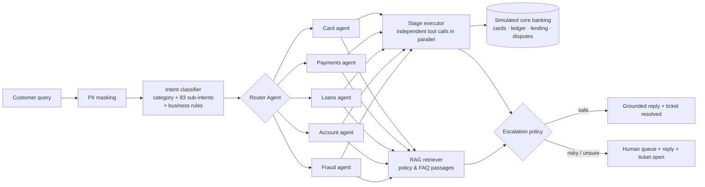

# Agentic resolution layer

The NLP system (see [ARCHITECTURE.md](ARCHITECTURE.md)) classifies a message and routes it to a team.
This layer goes one step further: it **resolves** the query when it safely can, and hands it to a
human when it should not.

```
Customer query → PII masking → Intent classification → Router Agent → Specialised Agent
             → [Tool calls ∥ RAG retrieval] → Action → Human-in-the-loop check → Response
```



## Components

| Component | Code | What it does |
|---|---|---|
| Intent classifier | `bankq/routing/router.py` (unchanged NLP system) | Category, sub-intent, confidence, fraud and priority rules |
| Router Agent | `bankq/agents/router_agent.py` | Chooses the specialist; pulls a query to the Fraud agent when fraud probability ≥ 30%; follows a confident sub-intent over a weak category |
| Specialised agents | `bankq/agents/specialists.py` | Card, Payments, Loans, Account and Fraud agents. Each plans tool calls in **stages** and turns results into facts, next steps and escalation reasons |
| Tools | `bankq/agents/tools.py` | Simulated banking tools: `verify_transaction`, `block_card`, `check_loan_eligibility`, `create_dispute`, `check_payment_status`, `get_account_status`, `list_recent_transactions`, `get_loan_details`, `reset_passcode`, `get_verification_requirements`. Deterministic per customer, thread-safe, optional simulated latency |
| RAG | `bankq/agents/rag.py`, `knowledge_base/*.md` | 30 policy passages (cards, payments, loans, account, fraud), TF-IDF 1–2-gram index, category-filtered cosine search |
| Entities | `bankq/agents/entities.py` | Amount, currency, tenure, loan type and merchant from the masked text |
| Escalation (HITL) | `bankq/agents/escalation.py`, `configs/agent_policy.yaml` | Decides when a human must take over |
| Responder | `bankq/agents/responder.py` | Template reply built only from tool results and retrieved passages (with citations); pluggable for a generative model |
| Orchestrator | `bankq/agents/orchestrator.py` | Runs the whole flow, records a full trace and timings |
| API | `bankq/api/routes/resolve.py` | `/api/v1/resolve`, `/api/v1/resolve/batch`, `/api/v1/agents`, `/api/v1/knowledge/search` |
| UI | `web/assistant.html` (`/assistant`) | Chat-style resolver with agent trace, RAG sources and a parallel batch comparison |

## What each agent does

| Agent | Typical intents | Tool plan |
|---|---|---|
| Fraud | card payment not recognised, compromised / lost / stolen card, lost phone | Stage 1 `verify_transaction` → Stage 2 `block_card` ∥ `create_dispute`. Lost/stolen: `block_card` ∥ `list_recent_transactions`. Scams: evidence only, always human |
| Payments | pending / failed / reverted payments, refunds, duplicate charges | `check_payment_status` or `list_recent_transactions`; duplicate charge ≤ £100 → `create_dispute` |
| Loans | application, interest, repayments, closure | `check_loan_eligibility` ∥ `get_loan_details` |
| Cards | declines, not working, swallowed, delivery, PIN | `get_account_status` ∥ `list_recent_transactions(declined)`; swallowed → `block_card` |
| Account | passcode, identity verification, details, closure | `reset_passcode`, `get_verification_requirements` or `get_account_status` |

## Human-in-the-loop rules

A case is escalated (ticket stays **open** in the right team's queue, the customer is told who will
contact them and when) if any of these hold:

1. The classifier was unsure (confidence below the 60% review threshold). **No tools run** — the agent never acts on a guess.
2. A sensitive business rule fired: vulnerable customer, formal complaint, account takeover.
3. The agent raised a reason: scam / APP fraud, unrecognised payment ≥ £500, high transaction risk score,
   loan above £25,000, signs of financial hardship, failed identity verification, account closure,
   a disputed charge above the automatic limit.
4. A tool call failed.
5. The answer is not grounded: the best policy passage scored below `min_grounding_score`.

Protective actions (blocking a card) still happen before the hand-off, and the reply says so.

Otherwise the ticket is created and immediately marked **resolved**, with the agent's actions and reply
recorded as ticket events (actor `agent:<name>`), so the existing Inbox and Analytics views show
automated and human work side by side.

## Safety properties

- PII is masked before classification; agents, tools, logs and tickets only see masked text.
- Every sentence in a reply comes from a tool result or a cited policy passage.
- Side-effecting tools (`block_card`, `create_dispute`, `reset_passcode`) are flagged in `/api/v1/agents`.
- Thresholds live in `configs/agent_policy.yaml` and reload with `POST /api/v1/admin/reload-model`.
